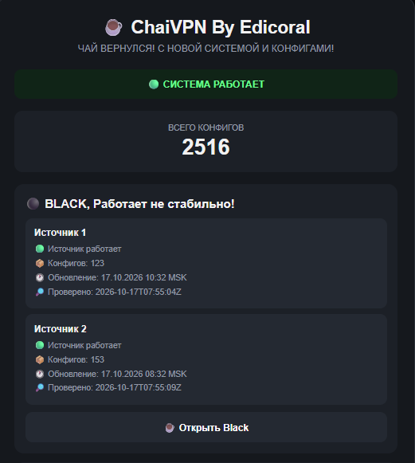
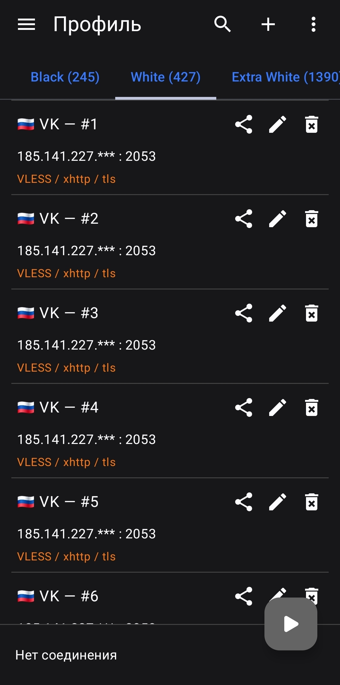

# ☕ ChaiVPN by Edicoral

**Коллекция VPN-конфигураций с автоматическим обновлением.**

ChaiVPN — проект, который объединяет источники конфигураций в отдельные группы подписок и автоматически обновляет их с помощью GitHub Actions.

## ✨ Возможности

- 🔄 **Автоматическое обновление** — источники регулярно проверяются и обновляются.
- 🖤 **BLACK** — основная группа конфигураций для обычного использования.
- 🤍 **WHITE** — дополнительная группа конфигураций для обхода БС.
- 🔴 **EXTRA-WHITE** — отдельная группа с дополнительными конфигурациями для обхода БС и обычного использования.
- ☁️ WARP-генератор — генерация WARP-конфигураций.
- 📱 **Поддержка Happ и других клиентов** — подписки с понятными названиями профилей.
- 🌐 **Статусная страница** — информация о доступности источников и времени обновления.
- 🛠️ **GitHub Actions** — автоматическая обработка источников и обновление файлов.

## 📸 Скриншоты

### 🌐 Сайт проекта

### 📱 Подписки в Happ,ZedSecure и V2rayng

  
  
  

## 📂 Структура проекта

| Файл | Описание |
|---|---|
| `index.html` | Сайт проекта со статусами источников |
| `status.json` | Данные о состоянии источников |
| `sub-black.txt` | Подписка BLACK |
| `sub-white.txt` | Подписка WHITE |
| `sub-extra-white.txt` | Подписка EXTRA-WHITE |
| `.github/workflows/` | Сценарии автоматического обновления |

## 🔄 Автоматическое обновление

ChaiVPN использует GitHub Actions для периодического получения исходных файлов, их обработки и обновления готовых подписок.

Частота обновления и доступность подписок зависят от состояния исходных источников.

## ⚠️ Важная информация

ChaiVPN — независимый проект. Доступность и совместимость конфигураций зависят от исходных источников и используемых клиентских приложений.

Используются конфиги от Cyberportal, zieng2, etoneya и rjsxd (whoahaow)

Проект не гарантирует постоянную доступность, определённую скорость или совместимость со всеми клиентами.

## 👤 Автор

**Edicoral aka OlenniyPenis**

Если проект оказался полезным, поставьте ему ⭐ на GitHub!

---

*Создано благодаря ВайбКоду.*
